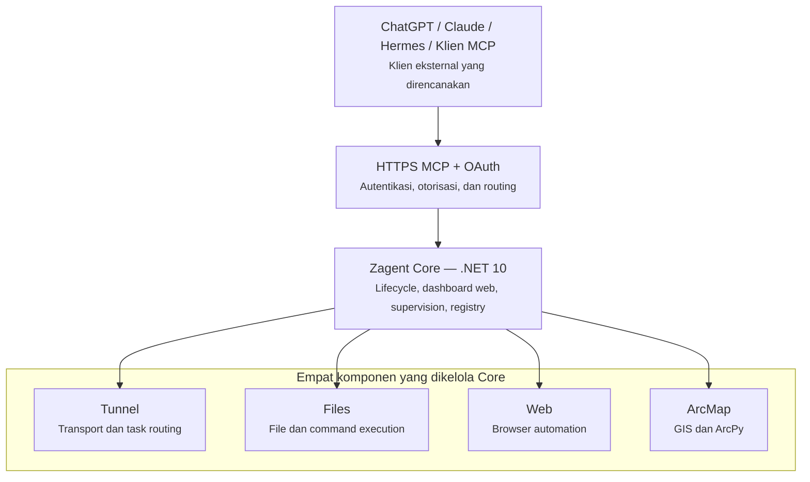

# Zagent Multi Platform — Arsitektur Target yang Diinginkan Pengguna

**Status:** **TARGET ARSITEKTUR / USER-APPROVED DESIGN**. Dokumen ini merupakan sumber kebenaran untuk arah pengembangan Zagent Multi Platform sebagaimana ditetapkan pengguna melalui diagram pada 2 November 2026. Ini **bukan** klaim bahwa seluruh hubungan dan integrasi sudah terimplementasi atau lulus uji produksi.

## Diagram arsitektur target (sesuai gambar pengguna)



Urutan **logis yang harus dipertahankan** ketika menjelaskan sistem:

```text
ChatGPT / Claude / Hermes / Klien MCP
                  |
                  v
           HTTPS MCP + OAuth
     (autentikasi, otorisasi, routing)
                  |
                  v
         Zagent Core — .NET 10
 (lifecycle, dashboard, supervisor, registry)
                  |
       +----------+----------+----------+----------+
       |          |          |          |          |
     Tunnel     Files       Web       ArcMap
   transport/  file dan    browser    GIS dan
      task     command    automation   ArcPy
    routing   execution
```

Diagram ini merupakan diagram **tingkat sistem**, bukan sequence diagram yang menyatakan semua permintaan HTTP harus diproksi langsung oleh proses .NET. Kontrak network/API dan ownership MCP Router yang tepat harus memenuhi struktur tersebut saat implementasi.

## Makna tiap lapisan

1. **Klien MCP eksternal**: ChatGPT, Claude, Hermes, dan klien MCP berbasis standar lain memiliki kedudukan setara. Klien tidak mendapatkan privilege hanya dari nama atau jenis modelnya.
2. **HTTPS MCP + OAuth**: satu gerbang MCP publik Zagent Multi Platform untuk autentikasi, otorisasi, validasi resource/audience/scope, serta routing. *Authorization server* (misalnya Keycloak) merupakan layanan OAuth pendukung, bukan agent kelima. Endpoint MCP yang dipersiapkan: `https://zagent.ikbalzohr.web.id/mcp`. URL tersebut **pernah digunakan untuk integrasi Hermes**, tetapi saat ini **tidak boleh diasumsikan aktif atau sudah siap multi-client** tanpa verifikasi langsung.
3. **Zagent Core (.NET 10)**: pusat pengelolaan produk, bertanggung jawab atas lifecycle, dashboard web lokal, supervision, konfigurasi, capability registry dan koordinasi keempat komponen. Dashboard lokal terpisah dari autentikasi OAuth klien MCP.
4. **Tunnel**: komponen milik Multi Platform untuk transport dan task routing. Istilah **Tunnel** di sini adalah nama modul produk, **bukan** tunnel/API key milik Zagent Production. Implementasi dapat memuat MCP Router dan transport opsional; pemisahannya harus terdokumentasi.
5. **Files**: operasi file, filesystem dan perintah yang diotorisasi berdasarkan policy.
6. **Web**: otomasi browser dan kendali sesi web menurut policy.
7. **ArcMap**: operasi GIS/ArcPy, termasuk integrasi eksternal ArcMap Desktop sesuai prasyarat runtime/lisensi.

**Empat komponen utama di bawah Core adalah Tunnel, Files, Web, dan ArcMap.** QGIS dan integrasi MCP lain merupakan kemungkinan ekstensi, bukan pengganti atau komponen kelima yang otomatis masuk ke diagram dasar yang telah disepakati.

## Batas produk yang tidak boleh dilanggar

- **Zagent Multi Platform tidak memiliki dependensi runtime pada Zagent Production atau Zagent Dev.**
- Jangan menggunakan, menyalin, mengimpor, atau menganggap sama tunnel ID, API key, OAuth client, device ID, credential store, binding, approval, domain route atau konfigurasi Zagent Production.
- **Tunnel dengan API key yang digunakan Zagent Production adalah milik Zagent Production dan tidak ada hubungan dengan Multi Platform.** Keberadaan `TunnelTransportOptions` atau `tunnel-client.exe` dalam source Multi Platform tidak membuktikan penggunaan tunnel tersebut.
- Domain `https://zagent.ikbalzohr.web.id/mcp` dipersiapkan untuk Multi Platform, **bukan** domain yang perlu dimigrasikan dari Zagent Production. Jangan menulis prosedur 'cutover dari Production' berdasarkan asumsi tersebut.
- Pengaktifan endpoint HTTPS publik untuk Multi Platform harus memiliki ingress/transport **independen** yang dikonfigurasi dan diuji; tidak harus memakai API key tunnel Production dan tidak boleh bergantung padanya.
- Konfigurasi identitas dan grant OAuth dibuat khusus untuk Multi Platform; fail-closed saat belum disediakan. Tidak ada bypass otorisasi berbasis label Hermes, ChatGPT, Claude atau nama klien lain.

## Kesenjangan antara target dan kode saat ini

Ini adalah **ketentuan desain**, bukan pernyataan bahwa kode sudah mengikuti persis urutan gambar.

- Saat ini `agents/tunnel/engine/router/server.py` mengimplementasikan handler HTTPS-MCP resource-server pada proses Router Python. Core .NET mengelola Router/agent melalui supervisor dan registry. Karena itu eksekusi `tools/call` pada implementasi saat ini **dapat diteruskan Router langsung ke MCP upstream**, bukan selalu melalui proses Core. Diagram pengguna menampilkan **ownership dan orkestrasi terpusat di Core**, bukan keharusan menambah hop HTTP di Core.
- `src/Zagent.Core/Manager/ManagerCoreHost.cs` dan `TunnelProcessFactory.cs` masih mengenal transport terpisah yang opsional dan hanya diaktifkan ketika memiliki kredensial *khusus instalasi*. Mekanisme publikasi HTTPS Multi Platform belum boleh dianggap telah aktif.
- Konfigurasi Keycloak yang mengakomodasi ChatGPT, Claude dan Hermes masih harus diaktivasi dan diuji pada authorization server yang relevan. Pengujian offline tidak membuktikan kesiapan OAuth end-to-end.
- Perubahan arsitektur pada kode, khususnya memindahkan handler/router ke dalam proses Core, **tidak boleh dilakukan diam-diam hanya agar diagram terlihat identik**. Tetapkan kontrak, test keamanan, dan jalur migrasi sebelum refaktor.

## Acceptance criteria arsitektur

- Klien ChatGPT, Claude, dan Hermes dapat melakukan OAuth sesuai standar MCP, memperoleh token yang benar, lalu memanggil `initialize`, `tools/list`, dan satu tool read-only melalui endpoint Multi Platform.
- Semua jalur akses melakukan otorisasi OAuth dan policy yang sama; token tanpa issuer/audience/scope/grant yang benar harus ditolak.
- Core tetap menjadi pemilik lifecycle/supervisor/registry empat komponen (Tunnel, Files, Web, ArcMap).
- Dashboard lokal dapat dibuka tanpa menggunakan kredensial OAuth klien MCP.
- Tidak ada pemakaian atau perubahan tunnel/API key Zagent Production, dan tidak ada efek pada layanan Production saat menguji Multi Platform.
- Rangkaian test dan deployment harus diverifikasi secara terpisah; jangan mengklaim sudah siap hanya berdasarkan diagram atau source.

**Referensi terkait:** `docs/MCP_FIRST_ARCHITECTURE.md`, `docs/MCP-OAUTH-MULTICLIENT.md`, `README.md`.
