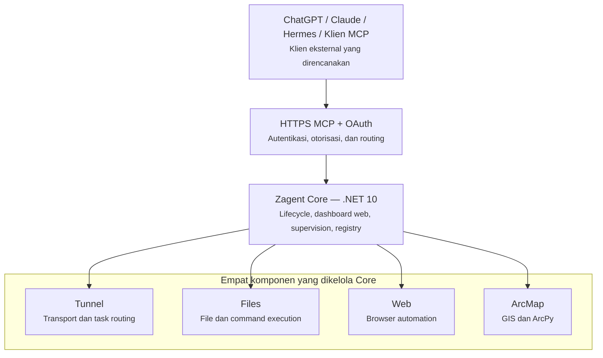

# Zagent Multi Platform — Arsitektur Target yang Diinginkan Pengguna

**Status:** **TARGET ARSITEKTUR / USER-APPROVED DESIGN**. Dokumen ini merupakan sumber kebenaran untuk arah pengembangan Zagent Multi Platform sebagaimana ditetapkan pengguna melalui diagram pada 2 November 2026. Ini **bukan** klaim bahwa seluruh hubungan dan integrasi sudah terimplementasi atau lulus uji produksi.

## Diagram arsitektur target (sesuai gambar pengguna)



Urutan **logis yang harus dipertahankan** ketika menjelaskan sistem:

```text
ChatGPT / Claude / Hermes / Klien MCP
                  |
                  v
           HTTPS MCP + OAuth
     (autentikasi, otorisasi, routing)
                  |
                  v
         Zagent Core — .NET 10
 (lifecycle, dashboard, supervisor, registry)
                  |
       +----------+----------+----------+----------+
       |          |          |          |          |
     Tunnel     Files       Web       ArcMap
   transport/  file dan    browser    GIS dan
      task     command    automation   ArcPy
    routing   execution
```

Diagram ini merupakan diagram **tingkat sistem**, bukan sequence diagram yang menyatakan semua permintaan HTTP harus diproksi langsung oleh proses .NET. Kontrak network/API dan ownership MCP Router yang tepat harus memenuhi struktur tersebut saat implementasi.

## Kontrak urutan startup Core (dikoreksi pengguna, 2 November 2026)

**Keputusan terbaru yang menggantikan ketentuan sebelumnya:** **Core, Tunnel, Files, Web, ArcMap, dan agent tambahan adalah komponen dengan lifecycle independen.** Core hanya mengoordinasikan **urutan percobaan startup**, bukan menegakkan saling ketergantungan atau menjadikan readiness satu agent sebagai syarat hidup agent lainnya.

- `Start All` mencoba **Files → Web → ArcMap → agent tambahan terdaftar (misalnya QGIS) → Tunnel Router**, secara berurutan. Setiap langkah menggunakan bounded health/readiness milik agent sendiri. **Kegagalan, exception, atau controller yang tidak terdaftar dicatat, tetapi tidak menghentikan percobaan startup berikutnya; Tunnel tetap dicoba.** Hasil keseluruhan melaporkan kegagalan agent yang sebenarnya, tidak memberi sukses palsu.
- `Start/Restart Tunnel` individual hanya mengoperasikan Tunnel. Tidak boleh otomatis menyalakan, mengubah, atau memerlukan readiness Files/Web/ArcMap/QGIS. Aksi individual agent lain juga tidak menjalankan peer.
- `Stop All` mencoba urutan terbalik (Tunnel → tambahan → ArcMap → Web → Files), dengan verifikasi proses berhenti. `Restart All` tetap melewati Stop All terlebih dahulu; kegagalan penghentian dapat membatalkan startup ulang untuk mencegah duplikasi proses, bukan karena dependensi antarlayanan.
- Tunnel Router boleh menghidupkan MCP endpoint dan menampilkan **katalog yang parsial** ketika satu atau beberapa upstream tidak siap. Status tiap upstream (`initialized`, jumlah tools, `last_error`) harus tersedia lewat diagnostik otentikasi internal; daftar `tools/list` hanya berisi tool yang sungguh ditemukan dan lolos authorization. Jangan mengarang capability, mengurangi OAuth scope, atau melebarkan grant untuk menyamarkan agent offline.
- Router melakukan discovery awal setelah urutan startup, lalu **retry background terbatas (default setiap 10 detik) terhadap upstream yang gagal** agar katalog pulih tanpa restart Core/Tunnel. Permintaan `tools/list` tidak boleh menunggu retry; klien yang cache tool list perlu melakukan rediscovery pada sesi/scan berikutnya.
- ArcMap Desktop/Chrome Bridge yang tidak terbuka harus dipisahkan dari health MCP agent; readiness integrasi eksternal tidak menjadi dependency untuk agent lain.

**Status implementasi pada 2 November 2026:** patch telah dibuat di **working tree source**, dan telah lulus **Core Debug build (0 warning, 0 error), ManagerTests 19/19, Router unittest 163 dengan 3 skip, SupervisorTests 11/11, ArchitectureTests 29/29**, serta sintaks tiga file Python. Dashboard policy test selesai dengan exit 0. **TunnelTests terpisah gagal 1 PASS / 4 FAIL** pada fixture lama (internal management channel belum diprovision, transport-client fixture tidak disetel, dan satu asumsi config mismatch); jangan dianggap PASS atau sebagai bukti bug startup baru. Hasil `MANAGER_TEST_PASS 16/0` sebelumnya adalah baseline lama dan telah digantikan hasil 18/0. **Live Core/Router runtime dan discovery end-to-end setelah patch NOT_RUN**, source belum dipasang ke instalasi aktif. Tidak ada restart/deploy/commit/push, dan Zagent Production tetap terisolasi.

## Isolasi port — hasil audit 3 November 2026

Audit aktual ke Zagent Master (Production) dan instalasi Multi Platform membuktikan duplikasi konfigurasi Core `18800` serta Development Gateway `18900–18999`. Port Router, Files, Web dan ArcMap instalasi Multi Platform berbeda dari Production. **Source default fresh install sekarang menggunakan blok `19100–19199`, QGIS `19150`, Development Gateway `19200–19299`, runtime development `19300–19399`.** Instalasi uji yang sudah dikonfigurasi tetap melayani Router `18812` dan endpoint lain pada `188xx`; hanya `core_port` installed diubah menjadi `18802`. Gateway installed masih `18900–18999` untuk kompatibilitas binary lama hingga publish/migrasi aman. Karena itu **isolasi total rentang installed masih PENDING**, dan source build PASS bukan runtime acceptance. Detail dan risiko: [PORT_ISOLATION_AUDIT_20261103.md](PORT_ISOLATION_AUDIT_20261103.md). Tidak ada perubahan Production, Cloudflare atau kredensial.

## Status instalasi uji — 3 November 2026

Kandidat lokal diinstal dengan SetupEngine: **7.014 file verified, 8 changed**, backup tersedia dan source Core Release terpasang. Konfigurasi persisted sekarang pada blok Multi Platform `191xx`, development `192xx`; HTTPS Dashboard tetap `19444`. Agent **belum start** karena perintah Core dari plugin diblokir executable allowlist (tidak ada bypass). Domain Cloudflare yang sebelumnya menunjuk ke Router `18812` belum disesuaikan; origin yang direncanakan **`http://127.0.0.3:19110`** hanya boleh disambungkan setelah listener siap. Karena release gate repository masih memiliki blocker, ini **instalasi uji / bukan promosi release**; live MCP/OAuth NOT_RUN. Bukti: `docs/INSTALLATION_20261103.md`.

## Inventaris profil lokal tanpa eskalasi — 3 November 2026

Full installed payload Multi Platform di folder final telah `Zagent.Setup verify` **7.014/7.014** setelah perbaikan Core Release. `appBridge` telah terdaftar, read-only, pada folder `workspace`. Jalur Dashboard `workspaces` tetap memerlukan grant owner admin; karena scope `files:write` dan capability `profile_management` belum ada, ditambahkan jalur **READ ONLY local-config** bagi Administrator untuk **menampilkan** nama/path/status profile tanpa membuat authority atau memperluas grant. Perubahan ini bukan tanda admin provisioning siap. Router/Files/Core live masih NOT_RUN karena allowlist, Cloudflare belum dipindah. Lihat `FULL_INSTALL_AND_DEFAULT_PROFILE_20261103.md`.

## Bukti koneksi klien dan branding Launcher — 3 November 2026 (malam)

Pengguna melaporkan berhasil mengalihkan origin Cloudflare sendiri serta mendapatkan `PING SUCCESS` dari ChatGPT ke Multi Platform (OAuth `files:read`, policy `oauth-read-v1`, 8 tools). Pemeriksaan independen dari Windows pada saat Core sempat aktif: Router lokal 19110 `/.well-known/oauth-protected-resource/mcp` HTTP 200, `/mcp` tanpa token 401, domain publik `/mcp` tanpa token 401, Keycloak issuer 200. Ini bukti konektivitas/auth dasar, **bukan** acceptance login/token/semua tool atau Claude. Jangan mengubah Keycloak jika issuer/public resource tetap sama.

Hanya ikon `Zagent.Launcher.exe` yang kemudian diubah menggunakan `image/zohrsystem.ico`, bukan arsitektur, Cloudflare, Core atau ikon Setup. Saat preflight pemasangan icon, Multi Platform sedang tidak aktif; setelah itu SetupEngine memasang hanya satu perubahan program, dan `verify` 7.014/7.014 PASS. Core tidak dijalankan lagi pada pekerjaan branding. Lihat `docs/LAUNCHER_ICON_20261103.md` dan `docs/CHATGPT_OAUTH_CONNECTION.md`.

## Makna tiap lapisan

1. **Klien MCP eksternal**: ChatGPT, Claude, Hermes, dan klien MCP berbasis standar lain memiliki kedudukan setara. Klien tidak mendapatkan privilege hanya dari nama atau jenis modelnya.
2. **HTTPS MCP + OAuth**: satu gerbang MCP publik Zagent Multi Platform untuk autentikasi, otorisasi, validasi resource/audience/scope, serta routing. *Authorization server* (misalnya Keycloak) merupakan layanan OAuth pendukung, bukan agent kelima. Endpoint MCP yang dipersiapkan: `https://zagent.ikbalzohr.web.id/mcp`. URL tersebut **pernah digunakan untuk integrasi Hermes**, tetapi saat ini **tidak boleh diasumsikan aktif atau sudah siap multi-client** tanpa verifikasi langsung.
3. **Zagent Core (.NET 10)**: pusat pengelolaan produk, bertanggung jawab atas lifecycle, dashboard web lokal, supervision, konfigurasi, capability registry dan koordinasi keempat komponen. Dashboard lokal terpisah dari autentikasi OAuth klien MCP.
4. **Tunnel**: komponen milik Multi Platform untuk transport dan task routing. Istilah **Tunnel** di sini adalah nama modul produk, **bukan** tunnel/API key milik Zagent Production. Implementasi dapat memuat MCP Router dan transport opsional; pemisahannya harus terdokumentasi.
5. **Files**: operasi file, filesystem dan perintah yang diotorisasi berdasarkan policy.
6. **Web**: otomasi browser dan kendali sesi web menurut policy.
7. **ArcMap**: operasi GIS/ArcPy, termasuk integrasi eksternal ArcMap Desktop sesuai prasyarat runtime/lisensi.

**Empat komponen utama di bawah Core adalah Tunnel, Files, Web, dan ArcMap.** QGIS dan integrasi MCP lain merupakan kemungkinan ekstensi, bukan pengganti atau komponen kelima yang otomatis masuk ke diagram dasar yang telah disepakati.

## Batas produk yang tidak boleh dilanggar

- **Zagent Multi Platform tidak memiliki dependensi runtime pada Zagent Production atau Zagent Dev.**
- Jangan menggunakan, menyalin, mengimpor, atau menganggap sama tunnel ID, API key, OAuth client, device ID, credential store, binding, approval, domain route atau konfigurasi Zagent Production.
- **Tunnel dengan API key yang digunakan Zagent Production adalah milik Zagent Production dan tidak ada hubungan dengan Multi Platform.** Keberadaan `TunnelTransportOptions` atau `tunnel-client.exe` dalam source Multi Platform tidak membuktikan penggunaan tunnel tersebut.
- Domain `https://zagent.ikbalzohr.web.id/mcp` dipersiapkan untuk Multi Platform, **bukan** domain yang perlu dimigrasikan dari Zagent Production. Jangan menulis prosedur 'cutover dari Production' berdasarkan asumsi tersebut.
- Pengaktifan endpoint HTTPS publik untuk Multi Platform harus memiliki ingress/transport **independen** yang dikonfigurasi dan diuji; tidak harus memakai API key tunnel Production dan tidak boleh bergantung padanya.
- Konfigurasi identitas dan grant OAuth dibuat khusus untuk Multi Platform; fail-closed saat belum disediakan. Tidak ada bypass otorisasi berbasis label Hermes, ChatGPT, Claude atau nama klien lain.

## Kesenjangan antara target dan kode saat ini

Ini adalah **ketentuan desain**, bukan pernyataan bahwa kode sudah mengikuti persis urutan gambar.

- Saat ini `agents/tunnel/engine/router/server.py` mengimplementasikan handler HTTPS-MCP resource-server pada proses Router Python. Core .NET mengelola Router/agent melalui supervisor dan registry. Karena itu eksekusi `tools/call` pada implementasi saat ini **dapat diteruskan Router langsung ke MCP upstream**, bukan selalu melalui proses Core. Diagram pengguna menampilkan **ownership dan orkestrasi terpusat di Core**, bukan keharusan menambah hop HTTP di Core.
- `src/Zagent.Core/Manager/ManagerCoreHost.cs` dan `TunnelProcessFactory.cs` masih mengenal transport terpisah yang opsional dan hanya diaktifkan ketika memiliki kredensial *khusus instalasi*. Mekanisme publikasi HTTPS Multi Platform belum boleh dianggap telah aktif.
- Konfigurasi Keycloak yang mengakomodasi ChatGPT, Claude dan Hermes masih harus diaktivasi dan diuji pada authorization server yang relevan. Pengujian offline tidak membuktikan kesiapan OAuth end-to-end.
- Perubahan arsitektur pada kode, khususnya memindahkan handler/router ke dalam proses Core, **tidak boleh dilakukan diam-diam hanya agar diagram terlihat identik**. Tetapkan kontrak, test keamanan, dan jalur migrasi sebelum refaktor.

## Acceptance criteria arsitektur

- Klien ChatGPT, Claude, dan Hermes dapat melakukan OAuth sesuai standar MCP, memperoleh token yang benar, lalu memanggil `initialize`, `tools/list`, dan satu tool read-only melalui endpoint Multi Platform.
- Semua jalur akses melakukan otorisasi OAuth dan policy yang sama; token tanpa issuer/audience/scope/grant yang benar harus ditolak.
- Core tetap menjadi pemilik lifecycle/supervisor/registry empat komponen (Tunnel, Files, Web, ArcMap).
- Dashboard lokal dapat dibuka tanpa menggunakan kredensial OAuth klien MCP.
- Tidak ada pemakaian atau perubahan tunnel/API key Zagent Production, dan tidak ada efek pada layanan Production saat menguji Multi Platform.
- Rangkaian test dan deployment harus diverifikasi secara terpisah; jangan mengklaim sudah siap hanya berdasarkan diagram atau source.

**Referensi terkait:** `docs/MCP_FIRST_ARCHITECTURE.md`, `docs/MCP-OAUTH-MULTICLIENT.md`, `README.md`.

## Status aktivasi MCP Full Catalog — 4 November 2026

Mode publikasi `catalog_exposure.mode=all_discovered` telah diterapkan **pada
instalasi uji Multi Platform secara offline**, tanpa mengubah arsitektur
Core/Tunnel/Files/Web/ArcMap maupun instalasi Zagent Production. Router
memverifikasi kebijakan yang diinferensi dari tiga upstream terdaftar dan
SetupEngine memverifikasi 7.015 file. Scope grant serta profil Files telah
disesuaikan untuk akses yang lebih luas, tetapi Keycloak client/token
full-scope dan Router/ChatGPT `tools/list` **belum tervalidasi live** karena
Multi Platform belum dinyalakan (Launcher ditolak oleh allowlist Production).
Catatan lengkap: `MCP_FULL_CATALOG_DEPLOY_20261104.md`.
## 4 November 2026 — QGIS sebagai additional Core-managed agent (source ready)

Atas permintaan pengguna, QGIS MCP upstream 0.15.2 telah diintegrasikan
ke `agents/qgis` dalam repository Multi Platform. Ini perluasan kelima
yang dikelola Core, bukan pengganti empat agent utama pada diagram target:
Core mengelola proses MCP Python3.12 pada port loopback `19150`, sedangkan
QGIS Desktop + pluginnya tetap eksternal dan menggunakan socket `9876`.
Router mempublikasikan tools dengan namespace `qgis` melalui koneksi OAuth
yang sama dengan Files/Web/ArcMap. Sebelum Router startup, QGIS termasuk
urutan percobaan startup tetapi kegagalannya tidak menghalangi komponen lain.

Source yang diuji: 125 tools terdaftar, MCP initialize/list/ping PASS,
QgisTests PASS, Core build PASS, Architecture 29/29, Manager 19/19,
Router 173 (3 SKIP), lokasi runtime relokasi PASS. **Instalasi Multi
Platform aktif belum dipasang ulang/restart**; tidak ada klaim katalog
QGIS live ChatGPT. Detil, batas keamanan, lisensi GPL dan aktivasi:
`docs/QGIS_AGENT_INTEGRATION_20261104.md`.
## 4 November 2026 — QGIS installed; live activation blocked

QGIS agent source (upstream 0.15.2) dan Core Release sudah disalin ke
instalasi Multi Platform yang ada **tanpa membuat backup baru**. Manifest
payload 7.015 → **12.001/12.001 verified PASS**. Installed Python3.12
MCP initialize, 125 tools, `ping` terhadap QGIS Desktop nyata PASS.
Namun proses Core saat pemeriksaan akhir masih OFFLINE dan upaya
`Zagent.Launcher.exe` dari tool Production ditolak oleh executable
allowlist. Tidak dilakukan bypass/konfigurasi ulang Production.
Katalog Dashboard dan ChatGPT setelah penambahan QGIS **NOT VERIFIED**.
Commit/push ditangguhkan sesuai syarat pengguna: semua live test PASS.
Referensi: `docs/QGIS_ACTIVE_INSTALL_20261104.md`.
## 4 November 2026 — QGIS live MCP acceptance completed

Core now manages QGIS as `qgis.service`; the owner's Dashboard shows
Ready/Running, the installed service binds loopback port 19150, and
the pre-existing authenticated Router exposes 499 total ChatGPT tools
including 125 QGIS tools. Read-only `qgis_ping` succeeded end-to-end.
Files/Web/Tunnel remain Ready; ArcMap remains independently Degraded
due to HTTP probe timeout. No production service or secrets changed.
Live acceptance supplements the earlier offline-only deployment notes.
## 4 November 2026 — owner-approved Files ancestor profile

The installed Files service now allows owner-approved ancestor profile
roots; private service targets remain protected at the file-operation
boundary. Dashboard committed read-only profile agent rooted at
D:\3-Ikbalzohr\Agent; live ChatGPT list/read PASS and read-only
write denial PASS. Existing appBridge default preserved.
See docs/PROFILE_PARENT_ROOT_FIX_20261104.md.
## 4 November 2026 — Hermes connected and chat profile administration fixed

Owner confirms Hermes Agent is connected to Zagent Multi Platform,
alongside the separately verified ChatGPT OAuth MCP client.
This is a shared service with independent client authorization,
not an integration through Zagent Production. See
docs/HERMES_CONNECTION_20261104.md.

ChatGPT direct profile administration previously failed because
the public Router rejected client-supplied MCP params._meta.
The installed Router was updated to ignore safe opaque transport
metadata while rejecting forged authority; direct ChatGPT
profile list/create/get/update/delete calls now PASS. See
docs/PROFILE_ADMIN_CHATGPT_FIX_20261104.md.